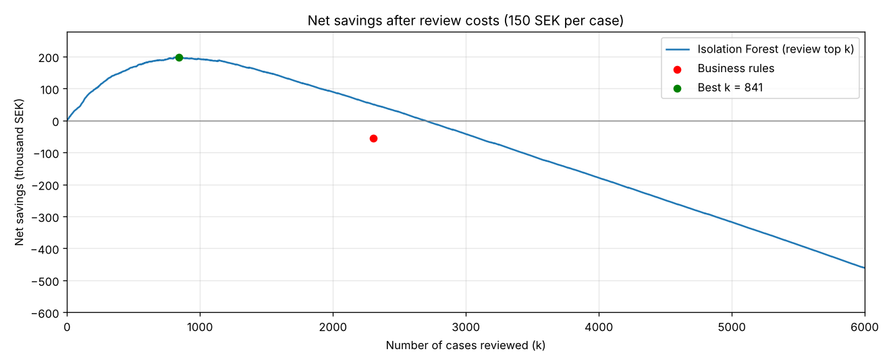
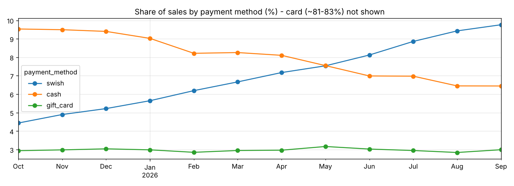

# Retail Payments: Cost-Sensitive Anomaly Detection

**Which refunds, voids and discounts should a loss-prevention team review first, so that the money recovered is larger than the cost of reviewing?**

This project analyses one year of (synthetic) point-of-sale transactions from a Swedish retail chain. It compares simple business rules with an **Isolation Forest** model, judged by **net savings after review costs** rather than accuracy.

## Key results (synthetic data, 150 SEK per review)
| | Business rules | Isolation Forest (best k) |
|---|---|---|
| Cases reviewed | 2,301 | 841 |
| Fraud cases found | 679 | 689 |
| Precision | 30% | 82% |
| Net savings | **−56,000 SEK** | **+198,000 SEK** |

- Rules catch fraud but flag too many honest cases, so they **lose money** once review time is counted.
- The model ranks cases, so the team can stop where an extra review no longer pays off.
- **Cashier-level behaviour**, compared with colleagues in the same store, carries much of the signal.
- The best number of reviews depends on the review cost (see the sensitivity table in the notebook).



## Payment trends in the data
The simulation includes a growing Swish share and a falling cash share, the direction seen in Swedish payment statistics.



## What is simulated and what is real
| Part | Status | Details |
|---|---|---|
| Transactions, cashiers and stores | **Simulated** | About 360,000 POS transactions created by `generate_data.py` |
| Fraud cases and labels | **Simulated** | Simplified versions of known schemes (fake refunds, "sweethearting", cash voids) |
| Payment mix trend (more Swish, less cash) | **Simulated, direction from real data** | Follows the direction in Riksbank payment statistics, not the exact levels |
| Review cost (150 SEK) and recovery | **Assumptions** | Would come from interviews with loss-prevention teams |
| Features, rules, Isolation Forest, net-savings evaluation | **Real** | The same code runs on real exception data |
| SQL queries | **Real** | Standard SQL (DuckDB), checked against the pandas results by the tests |

## Method
1. **Exceptions only**: refunds, voids and sales with ≥ 20% discount (5% of all transactions)
   - Features are built twice, in **pandas and in SQL** (`sql/exception_features.sql`), and checked to be identical
2. **Features**
   - *Transaction:* value at risk, hour, late hour, cash, refund without receipt, discount, round amount
   - *Cashier:* exception rate and late-hour share, as z-scores within the store
3. **Baseline rules**: refund without receipt, discount ≥ 50%, or cash void in the last two hours
4. **Isolation Forest** (scikit-learn): unsupervised, since in practice most fraud is never labelled
5. **Cost-sensitive evaluation**: net savings(k) = fraud value recovered in top k − review cost × k

## Project structure
```
retail-payments-anomaly-detection/
├── payments_anomaly_detection.ipynb   # full analysis (start here)
├── run_sql.ipynb                      # runs the SQL files and lets you try your own queries
├── detection.py                       # features, rules, model, evaluation
├── sql/
│   ├── exception_features.sql         # the model features in SQL (CTEs, joins, window functions)
│   └── business_questions.sql         # payment mix, refunds without receipt, top cashier per store
├── generate_data.py                   # creates the synthetic dataset
├── tests/                             # automated checks, incl. SQL = pandas (pytest)
├── images/                            # charts used in this README
└── data/                              # transactions.csv is created on first run (not uploaded: 26 MB)
```

## How to run
```bash
pip install -r requirements.txt
jupyter notebook payments_anomaly_detection.ipynb   # full analysis
jupyter notebook run_sql.ipynb                      # only the SQL queries
```
The first run creates `data/transactions.csv` (about a minute).

Run `pytest -q` for the automated checks: the SQL features must equal the pandas ones, the business queries must run, and the savings calculation is checked on a hand-made example.

The SQL is written for [DuckDB](https://duckdb.org), which runs inside Python with no database server. The dialect is close to PostgreSQL.

## About the data
All data is **synthetic**: 8 stores, 56 cashiers, about 360,000 transactions, amounts in SEK. Fraud patterns are simplified versions of common retail schemes: fake refunds, "sweethearting" discounts and cash voids. Real transaction data is confidential and personal (cashier IDs), so a real project would also need GDPR-compliant pseudonymisation.

## Limitations
- The data is synthetic, and the fraud patterns are simplified.
- Cashier-level features use the whole year. A live system would use only past data (rolling windows), so the results here are somewhat optimistic.
- Without real labels, the review cost and recovery rate are assumptions. As a thesis, these would come from interviews with loss-prevention teams.

## Related research
- Pierce, Snow & McAfee (2015). *Cleaning House: The Impact of Information Technology Monitoring on Employee Theft and Productivity.* Management Science 61(10).
- Correa Bahnsen, Aouada & Ottersten. *Ensemble of Example-Dependent Cost-Sensitive Decision Trees.*
- Liu, Ting & Zhou (2008). *Isolation Forest.* IEEE ICDM.

## Tools
Python (pandas, NumPy, scikit-learn, Matplotlib), SQL (DuckDB), pytest, Jupyter

## License
MIT. See [LICENSE](LICENSE).
